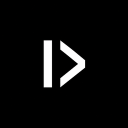
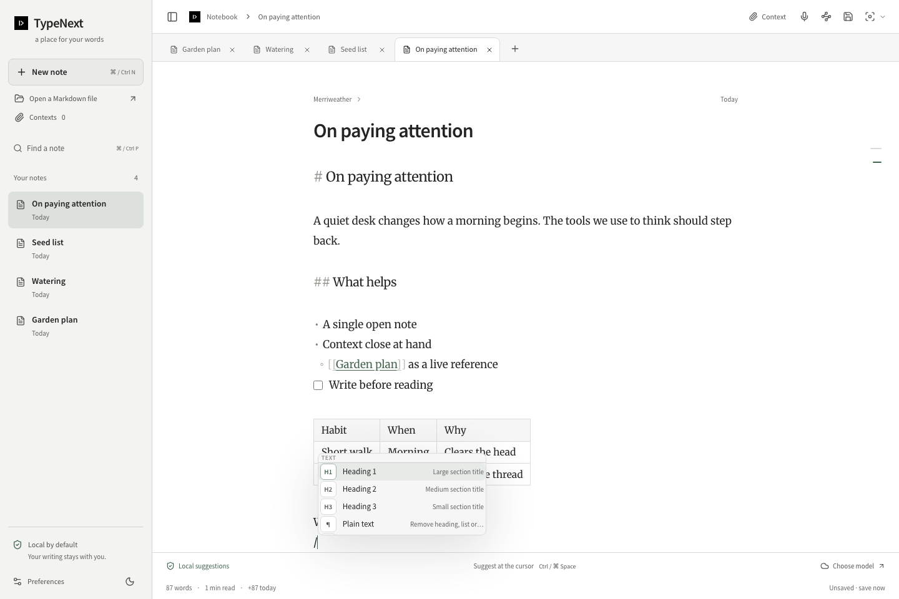
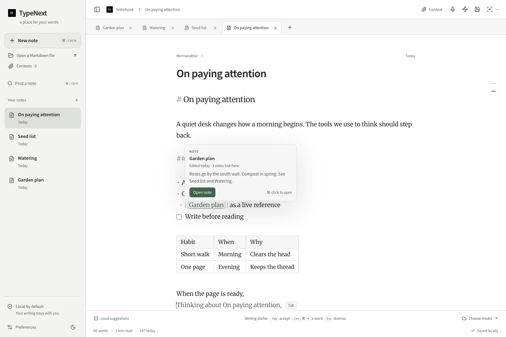
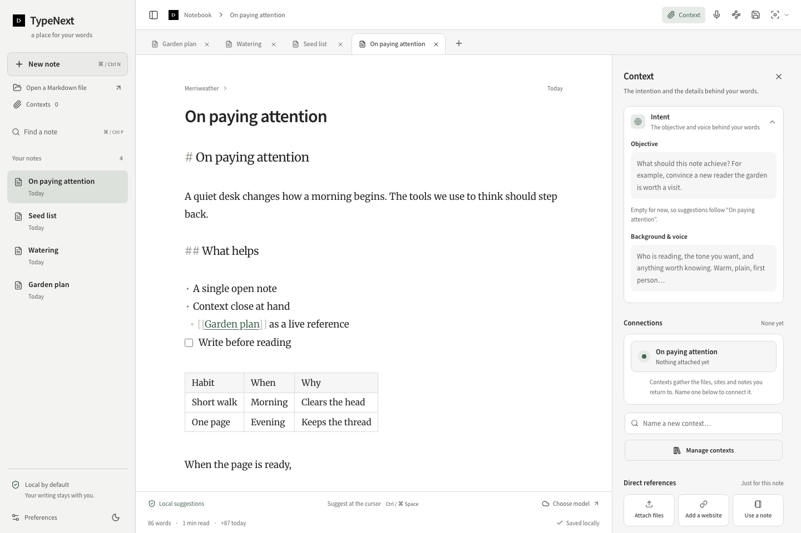
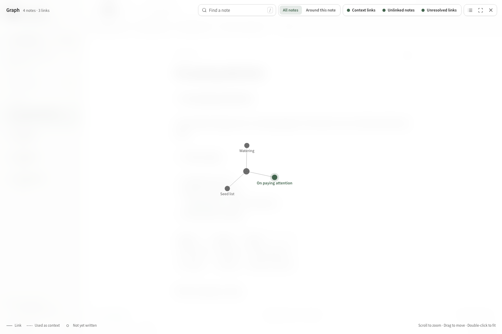
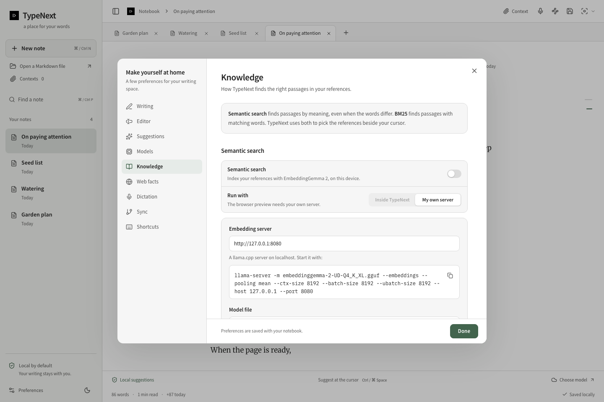
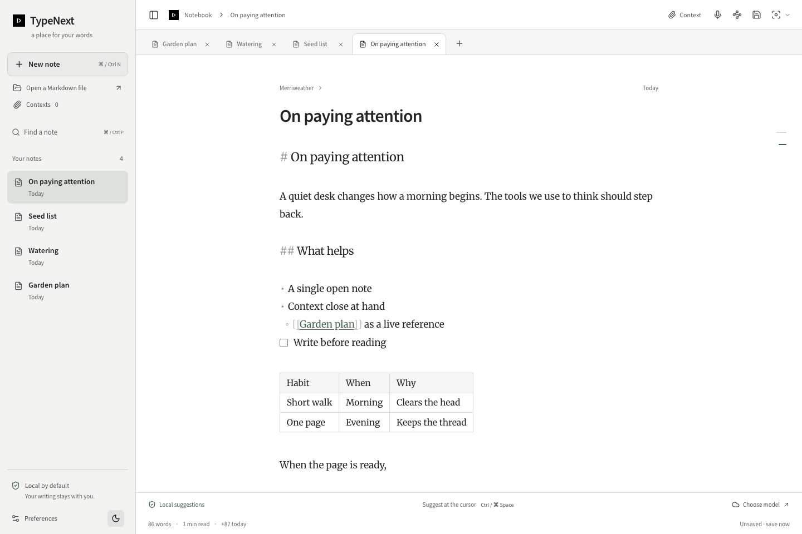
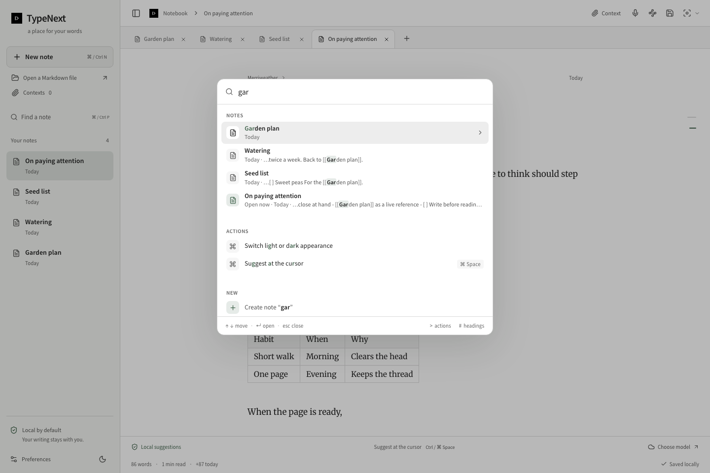
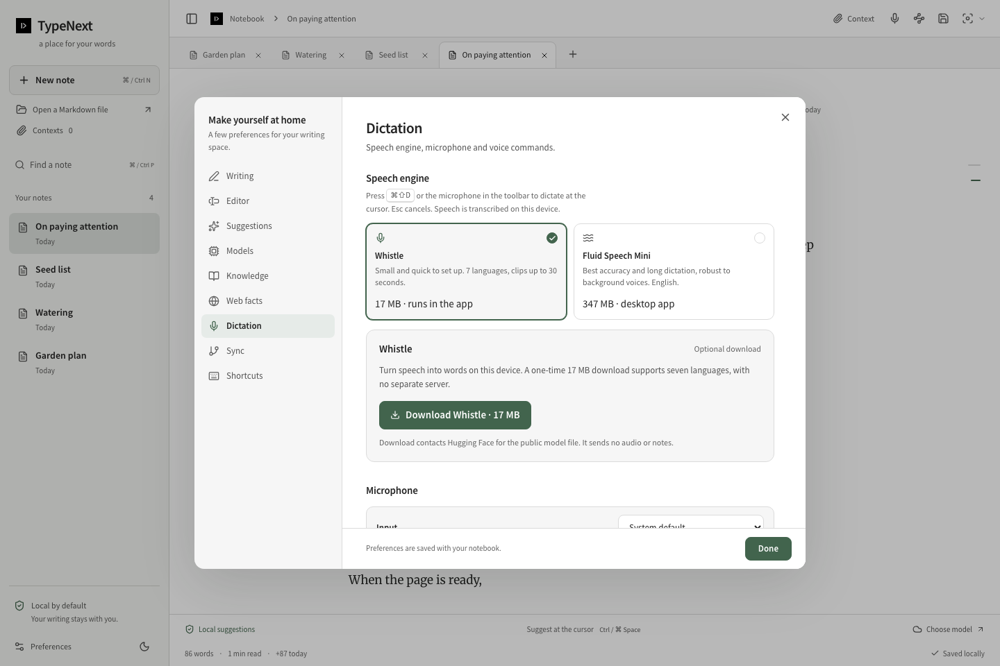

<div align="center">



# TypeNext

### You write. AI suggests.

A quiet, local-first Markdown notepad. A suggestion from your own files waits at the cursor, and **Tab** keeps it. Or dictate: speech becomes text on your device. Your notes never leave your computer unless you decide.

[](https://github.com/alshell7/typenext/releases/latest)
[](https://github.com/alshell7/typenext/releases)
[](LICENSE.md)

[](https://github.com/alshell7/typenext/stargazers)

**[⬇ Download](https://github.com/alshell7/typenext/releases/latest)** · **[Website](https://alshell7.github.io/typenext/)** · **[User guide](docs/userguide/userguide.md)** · **[What's new](docs/release-notes)**

<a href="docs/media/typenext-film.mp4"></a>

<sub><b><a href="docs/media/typenext-film.mp4">▶ Watch the 45-second film with sound</a></b> · recorded in the real app</sub>

</div>

---

## Why TypeNext

|     |     |
| --- | --- |
| ✍️ **Your voice first** | Suggestions are short and optional. Nothing enters the page until you press Tab. |
| 🔒 **Local by default** | Recall, the built-in model, semantic search and dictation run on your computer. |
| 🧠 **It knows your material** | Attach files, PDFs, websites, notes, even images, audio and video. Suggestions use what matters at the cursor. |
| ⚡ **Fast and calm** | In our tests, each key fits in one frame, even with 400 notes. No toolbars in your way, three levels of zen. |
| 🔗 **Notes that connect** | `[[links]]` with hover cards, backlinks, an outline, and a living graph. |
| 🧩 **Your choice of model** | On-device, LM Studio/Jan/llama.cpp, or OpenRouter, OpenAI, Anthropic and Cloudflare when you turn one on. |

## A tour

<p align="center"></p>

<table>
<tr>
<td width="50%"><br /><sub><b>Type <code>/</code></b> for headings, lists, tables, code, links, dates and your own snippets.</sub></td>
<td width="50%"><br /><sub><b>Type <code>[[</code></b> to link a note. Hover to preview. ⌘/Ctrl-click to open.</sub></td>
</tr>
<tr>
<td><br /><sub><b>Drag a context onto your note.</b> Set the intent once; suggestions follow it.</sub></td>
<td><br /><sub><b>See how your ideas connect</b> with ⌘/Ctrl Shift G.</sub></td>
</tr>
<tr>
<td><br /><sub><b>Semantic search on your device</b> with Google EmbeddingGemma 2, beside BM25.</sub></td>
<td><br /><sub><b>Light, dark, contrast</b> and your own palette.</sub></td>
</tr>
<tr>
<td><br /><sub><b>⌘/Ctrl P</b> finds notes, headings and every action.</sub></td>
<td><br /><sub><b>Dictation on your device</b> with Whistle or Fluid Speech Mini.</sub></td>
</tr>
</table>

## What you get

**Writing**

- **Start at once.** ⌘/Ctrl N and type. The first line becomes the title.
- **A real Markdown editor.** Live bullets, task boxes and tables. Tab moves between cells and indents lists. Enter continues lists.
- **Command palette.** ⌘/Ctrl P finds notes, headings and every action.
- **Writing flow.** A format bar on selection, typewriter scrolling, paragraph or sentence focus, smart typography (`--` → —), a daily word goal, and links from pasted addresses with the page title.
- **Zen mode.** Hide the side panels, hide all toolbars (they return at the edges), or go full screen.

**Suggestions that understand your work**

- **Recall and starters** work offline with no setup.
- **Hybrid retrieval**: BM25 finds matching words; optional **EmbeddingGemma 2** finds matching meaning, also in images, audio and video. TypeNext downloads, verifies and runs it locally.
- **Structure-aware**: a heading stays a heading, a list item stays one item, a table cell gets a few words.
- **Your rhythm**: TypeNext waits while you type fast and offers sooner at a pause.
- **Web facts** (opt-in): select text, press ⌘/Ctrl Shift K, and insert a cited fact.

**More**

- **Dictation on your device**: Whistle (17 MB), or **Fluid Speech Mini** by FluidVoice (347 MB) with live phrases, voice commands and auto-stop.
- **Git sync**: every note as a Markdown file in your repository. Both versions survive a conflict.
- **Updates in the app**: signed updates from GitHub releases download quietly; TypeNext asks before it restarts.
- **Plain files**: open and save ordinary Markdown. Autosave keeps a recoverable copy.

Try it in a minute: select **Try a sample** on the welcome screen, put the cursor after "Guests arrive at Bramble House", press ⌘/Ctrl Space, then Tab.

## Private by design

| Stays on your computer | Leaves only when you turn it on |
| --- | --- |
| Notes, references, vectors and recordings | An external model: nearby writing and relevant context |
| Recall, the built-in model and local servers | Web facts: the selected text, to OpenAI |
| Semantic search and dictation | Git sync: notes, to your remote |
| API keys (in memory, or the OS vault if you choose) | Link previews: a request to the linked site, no note text |
| | Updates: a version check with GitHub, no notes (Preferences → Updates) |

Models download only when you ask, from pinned versions with SHA-256 checks. If Hugging Face asks for a sign-in, TypeNext shows a three-step guide. Details: [AI design](docs/ai-design.md) · [built-in models](docs/builtin-models.md) · [reliability](docs/reliability.md).

## Keyboard

|                                | macOS                 | Windows / Linux             |
| ------------------------------ | --------------------- | --------------------------- |
| Accept a suggestion · one word | Tab · ⌘ →             | Tab · Ctrl →                |
| Choices at the cursor          | ⌘ Space               | Ctrl Space                  |
| Command palette                | ⌘ P                   | Ctrl P                      |
| Insert menu · note link        | `/` · `[[`            | `/` · `[[`                  |
| Web facts                      | ⌘ Shift K             | Ctrl Shift K                |
| Dictation                      | ⌘ Shift D             | Ctrl Shift D                |
| Zen mode · note graph          | ⌘ Shift F · ⌘ Shift G | Ctrl Shift F · Ctrl Shift G |

All shortcuts are in the [user guide](docs/userguide/userguide.md#keyboard-shortcuts).

<details>
<summary><b>Build from source</b></summary>

Node.js **22.13 or later**, stable Rust, and the [Tauri prerequisites](https://v2.tauri.app/start/prerequisites/). Linux also needs `libdbus-1-dev`.

```sh
npm ci
npm run tauri:dev      # desktop app
npm run dev            # browser preview
npm run check:all      # types, lint, unit tests, cargo fmt and clippy
npm run test:e2e       # Playwright
```

Live provider, embedding and speech tests are opt-in; keys come from a local, untracked `.env`. See [testing](docs/testing.md), the [architecture guide](docs/developer/architecture-guide.md), the [editor](docs/developer/editor.md), [semantic search](docs/developer/semantic-search.md) and [Git sync](docs/developer/git-sync.md).

The website is a Vite and React app in `site` (`npm run site:dev`, `npm run site:build`). The Pages workflow publishes `site-dist`. The film is made from code; see [the film](docs/developer/film.md).

</details>

## Contributing

Keep the writing flow small, fast and keyboard-friendly. A change to suggestions must test cursor moves, cancellation, the text after the cursor, and the local/external privacy boundary. A change to storage must keep a recoverable copy. Start with [CONTRIBUTING](docs/CONTRIBUTING.md).

If TypeNext helps you write, a ⭐ helps other writers find it.

## Credits and license

[MIT](LICENSE.md) for TypeNext. Built with Tauri, React, CodeMirror and a small BM25 index. Optional models and runtimes are separate downloads with their own licences: [llama.cpp](https://github.com/ggml-org/llama.cpp) (MIT), [Google EmbeddingGemma 2](https://huggingface.co/google/embeddinggemma-2) (Apache 2.0), [parakeet.cpp](https://github.com/mudler/parakeet.cpp) (MIT), **Fluid Speech Mini by FluidVoice** (CC BY 4.0), SmolLM2 and Whistle (Apache 2.0). The website uses [React Bits](https://reactbits.dev). See the [licensing record](docs/licensing.md) and [third-party notices](public/notices/THIRD-PARTY-NOTICES.md).
