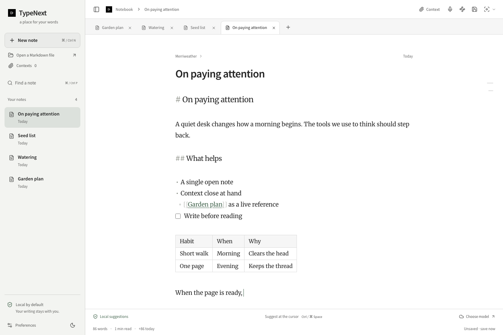
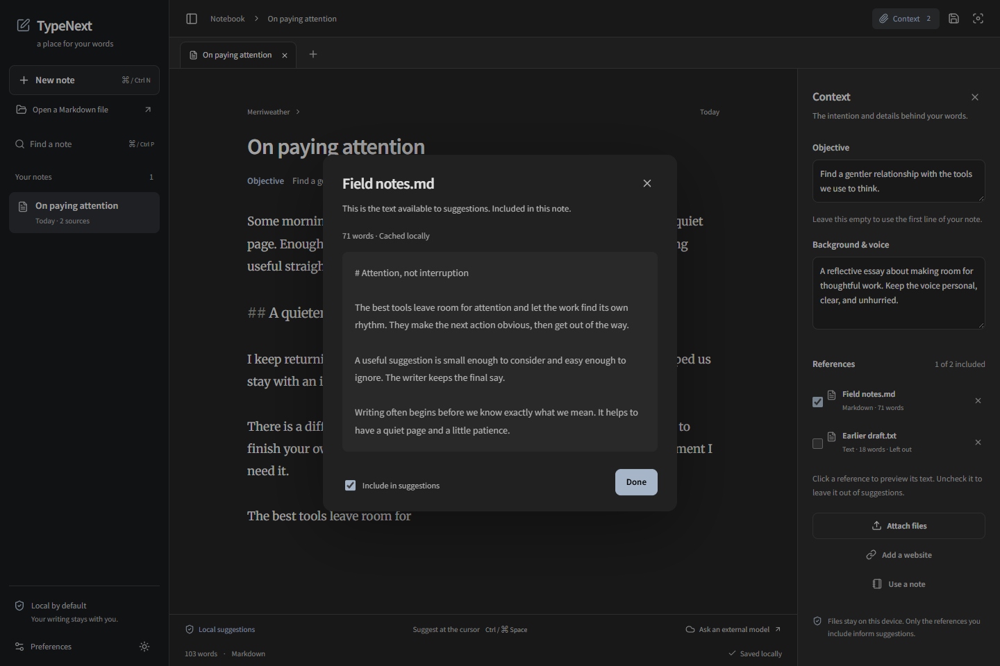
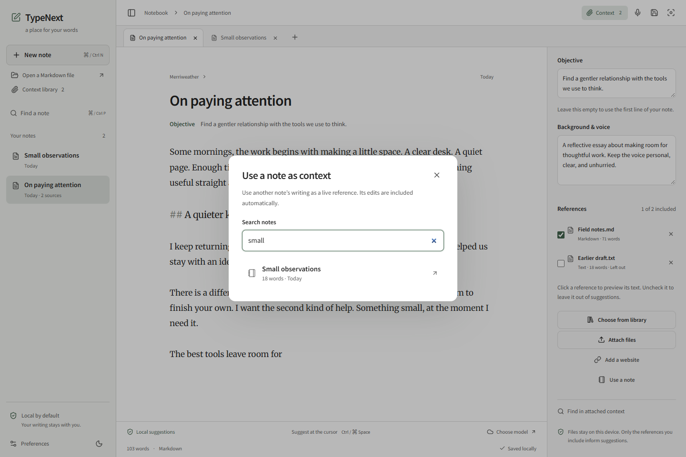
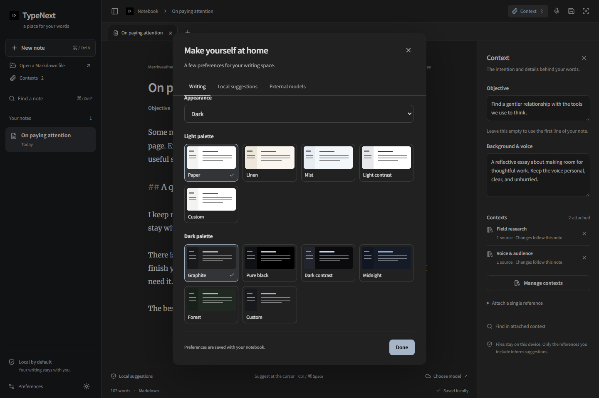
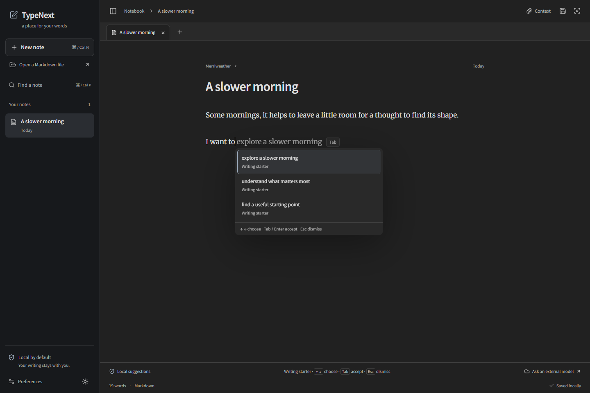
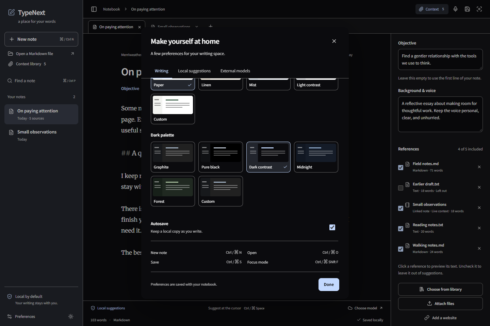
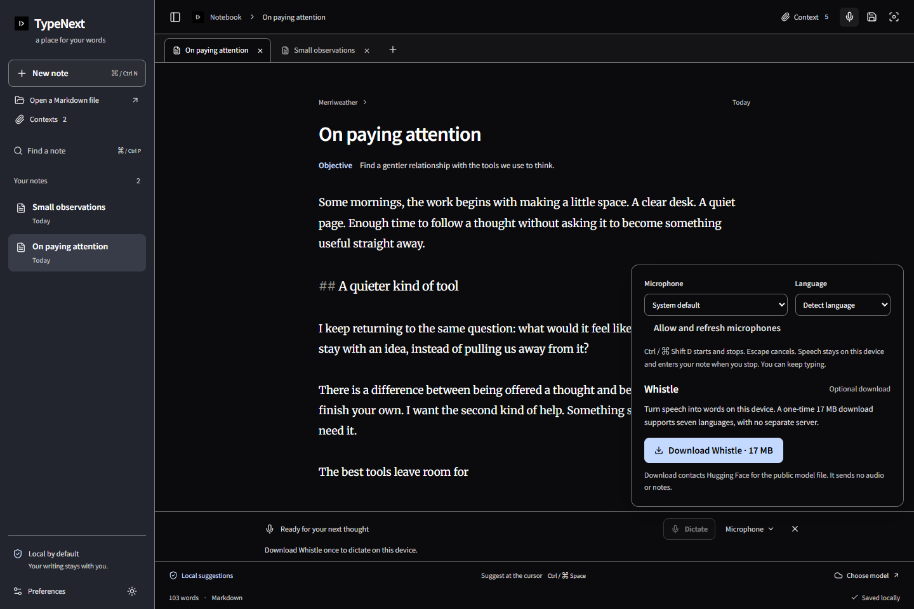

# TypeNext

A local-first Markdown notepad. You write. A suggestion at the cursor can help you continue, and you decide if it stays.



## Download

[Download for Windows and macOS](https://github.com/alshell7/typenext/releases/latest). Windows has a setup EXE, an MSI and a portable ZIP. Each Mac type (Apple Silicon and Intel) has a DMG and a ZIP. Linux builds from source. The [user guide](docs/userguide/userguide.md) tells you how to use each feature.

## Writing

- **Notes start at once.** Press Ctrl/⌘ N and type. An untitled note takes its title from its first line until you type a title. Set the objective and background later in the **Intent** section of the Context panel.
- **Markdown editor.** GitHub Flavored Markdown with live preview of bullets, task boxes, rules, quotes, code blocks and tables. Tab and Shift+Tab move between table cells and indent list items. Enter continues lists and adds table rows. Ctrl/⌘ Enter toggles a task.
- **Insert menu.** Type `/` at the start of a word for headings, lists, tables, code, links, the date and actions. Add your own commands in **Preferences → Editor**, with `{cursor}`, `{date}` and `{time}` tokens. You can change the trigger character.
- **Note links and the graph.** Type `[[` to link another note. Hover a link to see the note or the website title. Ctrl/⌘-click or Alt+Enter opens it, and a link to a missing note can create it. Ctrl/⌘ Shift G opens a graph of links, notes used as context and notes not written yet.
- **Contexts.** A context is a named group of references: files, folder snapshots, PDFs with text, DOCX files, websites, live notes, and (with semantic search) images, audio and video. Drag a context onto the note in the Context panel to attach it. Drag it back to detach it. Drop files on the panel or on a context card.
- **Zen mode.** Three levels: hide side panels, hide toolbars (they show at the top or bottom edge), or full screen. Ctrl/⌘ Shift F uses the saved level. Escape leaves zen.
- **Files and appearance.** Tabs, recent notes, local autosave, and ordinary Markdown files. Light, dark or system appearance, curated and custom palettes, and a choice of typeface and size. On macOS, the native window buttons are at the top left.
- **Dictation.** The optional Whistle model (a 17 MB download) transcribes speech on your device. Ctrl/⌘ Shift D starts and stops. Escape cancels.

New notebooks start empty. Select **Try a sample** on the welcome screen or in **Contexts** to open a fictional Bramble House note with two attached contexts. Put the cursor after "Guests arrive at Bramble House", press Ctrl/⌘ Space, then Tab. The default local recall mode completes the detail from the sample files, with no setup. The [sample files](examples/bramble-house) and a [ZIP](public/demo/typenext-sample.zip) are included. The sample does not change your notes or model settings.

Autosave keeps a recoverable previous version. Desktop saves replace complete files atomically. See [save and recovery behaviour](docs/reliability.md) and the [service](docs/services-resource-audit.md) and [editor](docs/editor-resource-audit.md) resource measurements.

<details>
<summary>Dark appearance and reference previews</summary>










</details>

## Suggestions and privacy

Suggestions start on your device. Tab accepts a suggestion, Ctrl/⌘ → accepts one word, and Escape dismisses it. Ctrl/⌘ Space opens a menu of choices at the cursor. Use the arrow keys to preview a choice, and Enter or Tab to accept it. A preview does not change the note.

| Engine                        | Where it runs                                                                            |
| ----------------------------- | ---------------------------------------------------------------------------------------- |
| **Writing starters & recall** | On your device. The default. No setup. Recalls phrases from your references and writing. |
| **Built-in SmolLM2**          | On your device, after a verified download of about 139 MB.                               |
| **Local server**              | LM Studio, Jan, Lemonade or llama.cpp on your computer.                                  |
| External providers            | OpenRouter, OpenAI, Anthropic or a custom endpoint, only after **Use continuously**.     |

Switch the engine with the searchable chooser in the status bar. Set up keys and saved models in **Preferences → Models**. While an external provider is active, it receives nearby writing, the objective, your instructions and relevant attached context. A local error never starts an external request.

**Retrieval is hybrid.** A local BM25 index finds passages with matching words. Optional **semantic search** with Google EmbeddingGemma 2 finds passages by meaning. Turn it on in **Preferences → Knowledge**:

- **Inside TypeNext** (desktop): TypeNext downloads the pinned llama.cpp `b11696` build (about 12–20 MB) and the model (Q4 175.7 MB or Q8 309.9 MB). It checks the SHA-256 of each file. It runs `llama-server` on a private loopback port with a random key, and stops it when the app closes.
- **My own server**: run the `llama-server` command that the pane shows.

If the embedding server is slow or stopped, TypeNext uses BM25 alone. Vectors stay in a local cache. With the optional media encoder (554.8 MB), images (up to 20 MB), audio (30 MB and 3 minutes) and video (50 MB and 45 seconds) become references. TypeNext keeps only the vector, a small thumbnail and the caption, not the file.

**Web facts** are optional. Select text and press Ctrl/⌘ Shift K, or choose **Search the web for facts** in the insert menu. TypeNext asks the OpenAI Responses API with web search for up to three cited facts. The accepted fact inserts Markdown links to its sources. A search sends the selected text, nearby writing, the note title and the objective to OpenAI, with your OpenAI key. OpenAI charges for each search.

What stays local and what leaves the device:

- Notes, extracted references and vectors stay on your device. Files are parsed locally.
- Desktop keys stay in memory unless you choose the operating system credential vault. Browser keys last for the session.
- Website import contacts the website. Optional Firecrawl import sends the address to Firecrawl.
- Link hover cards in **Notes & web** mode contact the linked website for its title. They send no note text.
- Model and runtime files download only when you ask. Whistle records and transcribes locally, and the microphone starts only from a dictation action.

A model can still get a fact wrong with the right passage. Scanned PDFs need OCR, and `.doc` files need conversion to `.docx` or text. Design details are in [AI design](docs/ai-design.md) and [built-in models](docs/builtin-models.md).

<details>
<summary>Contrast themes and dictation</summary>





</details>

The [prose FIM training recipe](docs/fim-training.md) includes a Colab notebook. No custom-trained checkpoint is shipped.

## Development

Node.js **22.13 or later** (or 24+), stable Rust, and the [Tauri prerequisites](https://v2.tauri.app/start/prerequisites/) for your platform are required for desktop development. Linux also needs `libdbus-1-dev` for the credential vault.

```sh
npm ci
npm run tauri:dev
```

To work on the interface in a browser:

```sh
npm run dev
```

The browser preview uses local browser storage and session keys. Servers must permit browser CORS; the desktop app uses its native HTTP bridge.

```sh
npm run typecheck
npm run lint
npm run test:run
npm run test:e2e
cargo test --manifest-path src-tauri/Cargo.toml
npm run tauri:build
```

Browser tests use installed Edge on Windows or Playwright Chromium elsewhere. Install the latter with `npx playwright install --with-deps chromium` when needed. `npm run test:native:windows` builds a separate test profile and exercises the real Windows WebView and Rust bridge. Live provider and embedding tests are opt-in and use synthetic text. Keys come from a local, untracked `.env` file and never from the repository. See [testing](docs/testing.md).

The active implementation is in `src/notebook`, `src/components/notebook`, the notebook services and `src-tauri/src`. The [editor](docs/developer/editor.md) and [semantic search](docs/developer/semantic-search.md) guides describe the new systems. Earlier template code is preserved but excluded from the active TypeScript project and production bundle. `package-lock.json` is the canonical dependency lockfile.

## Project website

The static project site is in `site`. Build it with `npm run site:build`. The Pages workflow publishes only `site-dist` to the `github-pages` environment when changes reach `main`.

The project website is live at [alshell7.github.io/typenext](https://alshell7.github.io/typenext/).

## Contributing

Keep the writing flow small, keyboard-friendly, and understandable in the app. Changes to suggestions should test cursor movement, cancellation, suffix preservation, and the local/external privacy boundary. Changes to the editor should keep the typing-latency test green. Changes to storage should preserve a recoverable copy and make failures visible.

TypeNext uses Tauri 2, React, TypeScript, CodeMirror 6, a small local BM25 index and optional llama.cpp embeddings. Source extraction uses PDF.js, Mammoth, and Mozilla Readability. See [third-party notices](docs/third-party.md) for bundled fonts and libraries.

## License

[MIT](LICENSE.md) for TypeNext-owned work. Bundled libraries, runtimes and fonts retain their upstream licenses; optional model weights are separate downloads. See the [licensing and provenance record](docs/licensing.md) and [complete third-party notices](public/notices/THIRD-PARTY-NOTICES.md).
